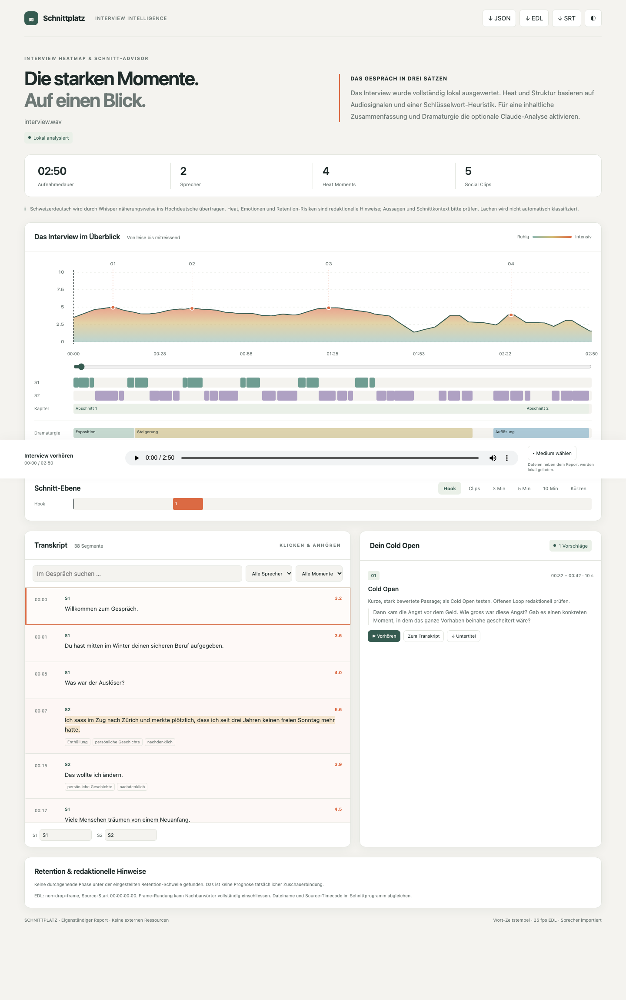

# Interview Heatmap & Schnitt-Advisor

Eine lokale Python-Pipeline für Interview-Aufnahmen: Wort-Zeitstempel, Sprecher, Audio-Merkmale, Heat-Kurve und Schnittvorschläge. Die Inhaltsanalyse läuft standardmässig mit **Ollama auf dem eigenen Laptop**. Ergebnis: **ein eigenständiger HTML-Report ohne Build, Server oder CDN**, dazu JSON, SRT, TXT und CMX3600-EDLs.



## Bebilderte Vorstellung

[Browser-Tour öffnen](http://localhost:8767/vorstellung/) · [PDF herunterladen](docs/vorstellung.pdf)

Acht Stationen führen mit authentischen Screenshots durch Upload, Verarbeitung, Heatmap, Transkript, Schnittvorschläge und Export. Jeder Schritt nennt die Aktion, das sichtbare Ergebnis und wichtige Prüfpunkte. Die Screenshots verwenden ausschliesslich eine selbst erzeugte synthetische Demo-Aufnahme. Die HTML-Tour enthält die Bilder direkt und funktioniert auch als lokale Datei; die PDF umfasst acht Seiten im Querformat.

Zum erneuten Erstellen:

```bash
python -m pip install -e '.[documentation]'
python scripts/capture_walkthrough.py demo.wav  # nur eine synthetische Demo-Aufnahme verwenden
python scripts/build_walkthrough.py
```

Das Aufnahmeskript führt die tatsächliche Pipeline in einer isolierten Auftragsverwaltung aus und erstellt keine fingierten Fortschrittsanzeigen. Die Erzeugung ist daher ein vollständiger lokaler Analyselauf mit entsprechendem Zeitbedarf. Dateien liegen in `docs/screenshots/`, `docs/vorstellung.html`, `docs/vorstellung.pdf` und zusätzlich `output/pdf/schnittplatz-vorstellung.pdf`.

## Installation

Empfohlen: **Python 3.12**; Mindestversion 3.11. ffmpeg und ffprobe müssen im PATH liegen.

```bash
# macOS
brew install python@3.12 ffmpeg
# Ubuntu/Debian: sudo apt-get install python3-venv ffmpeg libsndfile1

git clone https://github.com/Witzelfitz/interview-heatmap.git
cd interview-heatmap
python3.12 -m venv .venv
source .venv/bin/activate
python -m pip install -e '.[diarization]'
```

Für die lokale Inhaltsanalyse [Ollama](https://ollama.com/) installieren und starten:

```bash
ollama pull gpt-oss:20b
# Falls Ollama nicht bereits als App läuft: ollama serve
```

Bereits installierte lokale Chat-Modelle stehen in der Upload-App zur Auswahl. Das Projekt lädt keine Ollama-Modelle automatisch herunter. `gpt-oss:20b` ist ein Open-Weight-Modell unter Apache 2.0 und wurde hier auf einem Laptop mit 36 GiB RAM geprüft. Ein kleineres lokales Chat-Modell kann über die Oberfläche oder `--ollama-model` gewählt werden; dessen eigene Lizenzbedingungen gelten. Modellqualität, Geschwindigkeit und Speicherbedarf unterscheiden sich.

Die Sprechererkennung arbeitet wie bei noScribe mit lokal vorhandenen Modellgewichten. **Keine Anmeldung, kein Hugging-Face-Token und keine manuelle Freischaltung nötig.** Beim ersten Lauf lädt die Anwendung rund 33 MB öffentlich von der offiziellen noScribe-Distribution bei GitHub. Die Modelle werden unter `~/.cache/interview-heatmap/` gespeichert, an eine feste Revision gebunden und vor der Nutzung per SHA-256 geprüft. Es wird kein noScribe-Programmcode kopiert; noScribe muss nicht installiert sein.

Whisper lädt seine Modellgewichte ebenfalls beim ersten Lauf. Dabei werden **keine Interviewdaten hochgeladen**. Danach ist `--offline` möglich. Der erste Start benötigt eine Internetverbindung für die Modelldownloads; beschädigte oder unvollständige Downloads werden verworfen. Optional lässt sich das Cache-Verzeichnis mit `INTERVIEW_HEATMAP_MODEL_DIR` ändern. Attributionen und eigene Modelllizenzen stehen in [Drittkomponenten](THIRD_PARTY_NOTICES.md).

## Interview im Browser hochladen

```bash
source .venv/bin/activate
python server.py --port 8767
```

**[http://localhost:8767/](http://localhost:8767/)** öffnen, Aufnahme auswählen und **Interview hochladen & analysieren** drücken. Die Anwendung verarbeitet die Datei automatisch durch alle sieben Pipeline-Schritte, rendert standardmässig Hook und Social Clips und öffnet anschliessend den fertigen Report. Die Oberfläche zeigt Upload-Fortschritt, aktuellen Verarbeitungsschritt, Fehler und eine Liste bisheriger Interviews. Der frühere Pfad `/report.html` führt zur Upload-Seite; ein vorhandener Testreport ist unter `/demo/report.html` erreichbar.

Die Browser-Oberfläche braucht diesen lokalen Python-Server. Der erzeugte Report bleibt eine eigenständige HTML-Datei ohne Serverbedarf. **«Medium wählen» im fertigen Report** ersetzt weiterhin nur die Wiedergabedatei; eine neue Analyse startest du über **«+ Neues Interview»**.

- Automatische Sprechererkennung ist voreingestellt und benötigt kein Konto oder Token. Fehlende Modellgewichte werden automatisch geladen; die Erkennung findet lokal statt. **«Genau eine Stimme»** ist ausschliesslich für entsprechende Aufnahmen gedacht.
- **Ollama ist voreingestellt** und erstellt inhaltliche Zusammenfassung, Kapitel, Dramaturgie und Schnittvorschläge lokal. Dafür sind keine OpenAI-/Anthropic-Schlüssel nötig. Die einfachere Heuristik ist separat auswählbar. Claude bleibt ein ausdrücklich zu aktivierender Cloud-Modus; dabei wird Text an Anthropic gesendet.
- Die zusätzliche Checkbox für Remote-Whisper sendet Audio nur bei ausdrücklicher Auswahl an OpenAI. Zugangsdaten werden ausschliesslich im Arbeitsspeicher verarbeitet und aus gespeicherten Prozesslogs entfernt; sie stehen weder in Auftrags-JSON noch URLs oder Browser-Speicher.
- Uploads werden in Blöcken geschrieben, maximal 20 GiB pro Datei. Pro Aufnahme gibt es `output/uploads/<Auftrags-ID>/input/`, `output/`, `job.json` und `pipeline.log`. Originale werden nicht in öffentliche Repositories übertragen. Mehrere Aufträge werden nacheinander verarbeitet.
- Ein offener Browser-Tab ist nach dem Upload nicht erforderlich. Der lokale Server muss weiterlaufen. Nach einem Serverneustart erscheinen unterbrochene Aufträge als Fehler und können ohne erneuten Upload gestartet werden; passende Pipeline-Caches werden weiterverwendet. Unvollständige Uploads müssen erneut hochgeladen werden.
- Der Server bindet ausschliesslich an `127.0.0.1`. Fremde Origins und Hosts können keine Analyse starten. Eingaben, Logs und Caches werden nicht über die Report-URLs ausgeliefert. Audio-/Videodateien unterstützen Byte-Range-Anfragen für präzises Springen im Player.

Alternativ: `interview-heatmap-server --port 8767`. Ausgabeordner und Config sind mit `--data` bzw. `--config` wählbar. Es wird kein zusätzlicher Web-Framework-Stack benötigt.

## Ein Befehl

```bash
python heatmap.py interview.mp4 --out ./output --lang de
```

`output/report.html` per Doppelklick öffnen. Die extrahierte `audio.wav` liegt bereits daneben. Bei fehlendem Originalvideo verwendet der Player diese Audiospur. Mit `--copy-media` wird auch das Original zum Report kopiert; alternativ im Report **Medium wählen**. Die Datei wird dabei ausschliesslich im Browser geöffnet.

Standardmässig laufen **Transkription, Diarisierung, Audio- und Inhaltsanalyse lokal**. `--llm ollama` ist voreingestellt. Ohne laufendes Ollama oder passendes Modell erscheint eine klare Fehlermeldung; es gibt keinen stillen Wechsel zur Heuristik.

## Inhaltliche Analyse mit Ollama

```bash
python heatmap.py interview.mp4 --out output --llm ollama --ollama-model gpt-oss:20b
# Schneller Modus ohne LLM, z.B. für erste technische Tests:
python heatmap.py interview.mp4 --out output --llm local
```

Ollama erhält Transkripttext ausschliesslich über `127.0.0.1` bzw. IPv6-Loopback. HTTP-Proxies, Redirects, nicht lokale Hosts und Cloud-Modelle werden abgelehnt. Das Modell muss bereits installiert sein und darf laut `/api/show` kein Remote-Modell sein. Die Anwendung verändert keine globalen Ollama-Einstellungen. Wer zusätzlich Ollamas Cloud-Funktionen vollständig abschalten möchte, kann dies nach der [Ollama-Dokumentation](https://docs.ollama.com/faq#how-do-i-disable-ollamas-cloud-features) selbst konfigurieren.

Modell, Endpoint, Kontext, Ausgabeumfang und Zeitlimit stehen in `config.yaml` unter `analysis.ollama_*`. Standard: 32'768 Kontexttokens, 8'192 Ausgabetokens, 600 Sekunden pro Anfrage. Das Kontextbudget wird vor dem Senden konservativ geprüft. Ausgabe erfolgt mit JSON-Schema und wird zusätzlich in Python validiert; unvollständige Antworten werden nicht als fertige Analyse verwendet.

Lokale Modelle erhalten überlappende 150-Sekunden-Fenster. Der zweite Durchgang nutzt **alle Abschnittszusammenfassungen, alle Segment-Scores samt Zeitbereichen und eine Auswahl starker Originalpassagen**. Er sendet bewusst keine unbeschränkte Kopie des gesamten Worttranskripts in einen Laptop-Kontext. So bleibt auch die Gesamtanalyse langer Interviews begrenzt. Die verwendete Methode und der Digest der Modellgewichte stehen in `analysis.json`. Wenn selbst diese Übersicht nicht ins Budget passt, wird mit einem Hinweis abgebrochen. Fehlende IDs oder ungültige Dramaturgie werden bis zu zweimal erneut angefragt; ungültige Antworten werden nicht gecacht.

Laufzeit hängt von Interviewlänge, Modell und Hardware ab. Die Inhaltsanalyse eines langen Interviews kann deutlich länger dauern als die Transkription. Der Server zeigt das aktuelle Analysefenster; ein vorhandener LLM-Cache wird wiederverwendet.

## Optional: Inhaltliche Analyse mit Claude

```bash
python -m pip install -e '.[claude]'
# ANTHROPIC_API_KEY in der lokalen Shell setzen
python heatmap.py interview.mp4 --out ./output --lang de --skip-transcribe --llm claude
```

**`--llm claude` übermittelt Transkripttext an Anthropic.** Audio bleibt lokal. Ein vorhandener API-Key allein aktiviert keine Übermittlung. Der erste Durchgang bewertet überlappende 150-Sekunden-Fenster, der zweite das gesamte Transkript mit Abschnittszusammenfassungen und Scores. Claude empfiehlt auch Hooks und eigenständige Clips; die Pipeline prüft deren IDs, Dauer und reale Satzgrenzen. Ungültige Schnittfenster werden durch lokal gerankte Kandidaten ersetzt.

Modell und Fenstergrössen stehen in `config.yaml`. Vollständige strukturierte Antworten werden per JSON-Schema validiert. Nicht belegbare Zitate werden verworfen, ebenso unzulässige Scores; erfundene Segment-IDs oder überlappende Kapitel brechen den Lauf ab. Es gibt keinen stillen Wechsel von einem fehlgeschlagenen Claude-Aufruf zur Heuristik.

## Transkriptionsoptionen

```bash
# Nur Schritt 1–2, z.B. zum Prüfen einer kurzen Aufnahme
python heatmap.py test.mp4 --out output --transcribe-only

# Aufnahme mit tatsächlich nur einer Stimme (keine Sprechererkennung behaupten)
python heatmap.py monolog.wav --out output --single-speaker

# Zwei bekannte Stimmen; pyannote berechnet die Zuordnung weiterhin selbst
python heatmap.py interview.mp4 --out output --speakers 2

# CPU / geringerer Ressourcenbedarf
python heatmap.py interview.mp4 --out output --model medium --device cpu --compute-type int8

# Vorhandene, echte Diarisierung importieren
python heatmap.py interview.mp4 --out output --diarization-file turns.json
```

Format von `turns.json`: eine Liste mit `start`, `end` in Sekunden und `speaker` als ursprünglichem Label. Labels werden nach ihrem ersten Auftreten zu `S1`, `S2` usw. normalisiert. Nicht zuordenbare Wörter heissen **Unbekannt**. Überlappende Sprecherbereiche sind erlaubt. Ohne pyannote-Zugang wird keine erfundene Mehrsprecher-Erkennung angeboten; das bereits berechnete Whisper-Ergebnis bleibt im Cache.

Automatische Modellwahl: `large-v3` bei CUDA und ausreichend verfügbarem RAM, sonst `medium`. Bei Speicherfehlern von `large` folgt ein Versuch mit `medium` auf CPU/int8. Ein explizites `--model large-v3` ist möglich. faster-whisper nutzt auf Apple Silicon hier CPU/int8, keine Metal-GPU. Für NVIDIA müssen die zur installierten CTranslate2-Version passenden CUDA/cuDNN-Bibliotheken vorhanden sein, siehe [faster-whisper](https://github.com/SYSTRAN/faster-whisper).

Schweizerdeutsch wird näherungsweise ins Hochdeutsche transkribiert. CH-Orthografie wird vor der Zitatprüfung vereinheitlicht (`ß` → `ss`); jedes angezeigte Zitat muss danach ein **exakter zusammenhängender Teilstring seines Segments** sein. ASR-Zeitstempel und Sprecherlabels bleiben Modellschätzungen und müssen vor einem finalen Schnitt kontrolliert werden.

## Optional: Whisper-API

```bash
python -m pip install -e '.[remote]'
# OPENAI_API_KEY in der lokalen Shell setzen
python heatmap.py interview.mp4 --out remote-output --remote
```

**Nur `--remote` sendet Audio an OpenAI**, mit einem Warnhinweis in der Konsole. Die API liefert Wort-Zeitstempel über `whisper-1`/`verbose_json`. Längere WAV-Dateien werden in 600-Sekunden-Blöcke unter 25 MB aufgeteilt; Zeitstempel werden um den jeweiligen echten Blockoffset verschoben. An Blockgrenzen kann Kontext fehlen. Die Diarisierung bleibt lokal. Siehe die [offizielle Speech-to-Text-Dokumentation](https://developers.openai.com/api/docs/guides/speech-to-text).

## Cache und strikter Offline-Modus

```bash
# Dieselbe Quelle und dieselben Transkriptions-/Sprecheroptionen verwenden:
python heatmap.py interview.mp4 --out output --skip-transcribe

# Nur bereits heruntergeladene bzw. lokale Modelle verwenden:
python heatmap.py interview.mp4 --out output --offline \
  --model /pfad/zu/whisper-medium-ct2 \
  --diarization-model /pfad/zu/pyannote-community-1
```

`--offline` erlaubt weiterhin lokales Ollama auf Loopback, lehnt aber `--remote` und `--llm claude` ab und aktiviert den Offline-Modus von Hugging Face. pyannote-Telemetrie und Hugging-Face-Telemetrie sind immer deaktiviert. Ein Offline-Lauf benötigt sämtliche Modellgewichte bereits lokal; fehlende Sprechergewichte können einmal durch einen Lauf ohne `--offline` nachgeladen werden.

SHA-256 der Quelle, Sprache, Modell, Device, Präzision und Sprecheroptionen bestimmen den Transkript-Cache. Bei einem abweichenden Fingerprint bricht `--skip-transcribe` ab. Audio-Merkmale, einzelne LLM-Fenster und der Gesamtpass werden separat gecacht. Änderungen an Heat-Gewichten benötigen keine neue Transkription. Cache-Dateien werden atomar geschrieben. Zum gezielten Wiederholen einer Analyse die passende Datei in `output/cache/` entfernen.

## Scores und Schnittlogik

- RMS, Pitch-Variation in Halbtönen, Wörter/Sekunde, Pause vor dem Segment und Sprecherüberlappung werden pro Stimme mit z-Scores normalisiert. Nahezu konstante Pitch-Varianz wird nicht durch Messrauschen verstärkt. Audio-Score: Sigmoid aus gewichteten z-Scores.
- Lachen wird mangels zuverlässigem Klassifikator als `null` exportiert, nicht als vermeintlich gemessener Wert. Pitch aus YIN bleibt ein akustischer Erregungsindikator, keine Emotionsmessung.
- `heat_final = 0.6 * (heat_llm / 10) + 0.4 * audio_score`; bei `--llm local` ersetzt die gekennzeichnete Heuristik `heat_llm`. Gewichte in `config.yaml` müssen zusammen 1 ergeben.
- Ein-Sekunden-Kurve mit gleitendem Mittel über 15 Sekunden; Peaks über Mindestabstand und Prominenz. Stille wird als 0 berücksichtigt.
- Hooks: vollständige Sätze in 5–15 Sekunden. Social Clips: 15–60 Sekunden, höchstens acht nicht überlappende Vorschläge, Schluss und verifizierte Zitate werden bevorzugt. Fehlt geeignetes Material, werden weniger Vorschläge mit Hinweis ausgegeben.
- Kurzfassungen: chronologisch, Einstieg und Abschluss sowie starke Passagen je Dramaturgiephase. Gesamtdauer inklusive zusammengefügter Pausen bleibt im Zielbudget. Bei kurzem Ausgangsmaterial oder fehlenden Satzgrenzen ist die Auswahl kürzer.
- Kürzungshinweise: niedriger Heat, exakte Wiederholungen, dichte Füllwörter. Retention-Risiken: durchgehend mehr als 90 Sekunden unter dem konfigurierbaren Schwellenwert. Das sind redaktionelle Hypothesen, keine gemessenen Zuschauerreaktionen.

Schnitte verwenden echte Wortzeiten und erkannte Satzenden. Pausen-Puffer werden auf die tatsächlich freie Zeit bis zum Nachbarwort begrenzt. Bei der EDL-Frame-Rundung werden angeschnittene Nachbarwörter vollständig eingeschlossen. Das kann zusätzliche Wörter hinzufügen; JSON-Sekunden und EDL-Frames können daher leicht abweichen. Inhaltlicher Zusammenhang und eine Pointe lassen sich auch mit LLM nicht garantieren.

## Ausgaben

| Datei | Inhalt |
|---|---|
| `report.html` | Single-File-Report mit sämtlichen Analysedaten, Inline-CSS/JS, Export-Buttons |
| `report.json` | Gesamtdaten einschliesslich Exporttexten und Herkunft |
| `transcript.json` / `.srt` / `.txt` | Wortzeiten, Sprecher und Transkript |
| `audio_features.json` | Rohwerte, z-Scores und Audio-Score |
| `analysis.json` | Inhalt, belegte Zitate, Kapitel, Phasen, Höhepunkte |
| `heatmap.json` | Kombinierte Segment-Scores, Kurve und Peaks |
| `cuts.json` | Hook, Clips, Kurzfassungen, Kürzungen, Retention-Hinweise |
| `cuts.edl` | Standardmässig 5-Minuten-Auswahl, sonst Social-Clip-Auswahl |
| `hook.edl`, `clips.edl`, `short-3.edl` usw. | Separate Schnittsequenzen |
| `render-clips.sh`, `clips/*.srt` | Exakte ffmpeg-Kommandos und cliprelative Untertitel |
| `audio.wav`, `cache/` | Lokale Arbeitsdateien und wiederverwendbare Zwischenergebnisse |

Im Report: Zeitachse und Transkript sind gegenseitig verknüpft. Ein Clip spielt bis zu seinem Ende; Untertitel lassen sich pro Clip laden. Sprecher können lokal umbenannt werden; Namen und Farbschema bleiben im Browser gespeichert, und der JSON-Download enthält `speaker_names`. Der EDL-Button exportiert die gewählte Schnittversion. Das JSON enthält volle Daten, die Mediendatei bleibt separat. Bei Weitergabe nur des HTML-Reports funktioniert die gesamte Analyse; für Wiedergabe das Medium zusätzlich danebenlegen oder lokal auswählen.

## Clips rendern

```bash
python heatmap.py interview.mp4 --out output --skip-transcribe --render-clips
# Oder das erzeugte Skript später ausführen:
sh output/render-clips.sh
```

Hook und Social Clips werden mit Video/AAC bzw. Audio/AAC neu codiert. Kein ungenauer Stream-Copy-Schnitt an einem entfernten Keyframe. Es gibt keine automatische Hochformat-Beschneidung; Bildausschnitt und Gesichter vor der Veröffentlichung prüfen. Kurzfassungen sind zunächst Schnittlisten/EDLs, keine gerenderten Zusammenstellungen.

## EDL in Premiere / DaVinci Resolve

CMX3600, 24/25/30 fps **non-drop-frame**, Source-Start standardmässig `00:00:00:00`, Record-Start `01:00:00:00`. Video-EDLs verwenden `AA/V`, Audio-EDLs `A`. `* FROM CLIP NAME` enthält den Originaldateinamen, Reel ist `AX`. Medien müssen im Schnittprogramm lokal verknüpft werden.

1. Projekt-/Sequenz-Framerate passend zur Aufnahme wählen. `cuts.edl_fps` in einer Config setzen; 29.97/59.94 drop-frame wird nicht unterstützt. Bei VFR-Material vorab eine konstante Framerate herstellen und diese Datei analysieren.
2. Bei Quellmaterial mit eigenem Start-Timecode `--source-timecode 01:00:00:00` verwenden. Der CLI-Standard übernimmt den Container-Timecode nicht automatisch.
3. In Resolve **File → Import → Timeline**, in Premiere die EDL über **Datei → Importieren** öffnen. Originalmedium relinken, ggf. im Dialog die Framerate angeben.
4. Source-In/Out, Record-Dauer, Audio-/Videospuren und mehrere Übergänge gegen Transkript und Player prüfen. EDL ist verlustbehaftet und enthält keine Untertitel oder Effekte.

Die erzeugten Audio- und `AA/V`-Video-EDLs wurden mit dem unabhängigen OpenTimelineIO-CMX3600-Parser gelesen. Ein Import in Premiere/Resolve ist **noch nicht bestätigt**: Der Computerzugriff auf das installierte Premiere wurde vom Werkzeug nicht freigegeben.

## Tests und bisherige Validierung

```bash
python -m pip install -e '.[dev]'
pytest -q
ruff check .
ruff format --check .

# macOS: 2:50 Minuten synthetisches Zweistimmen-Interview erzeugen
python scripts/make_test_audio.py
python heatmap.py .local-tests/interview.wav --out test-output --model tiny \
  --diarization-file .local-tests/turns.json
python -m playwright install chromium
python scripts/verify_report.py test-output/report.html

# Echter Browser-Uploadtest inklusive automatischer Sprechererkennung
python scripts/verify_upload.py .local-tests/interview.wav --speakers auto --llm ollama
```

Die Testaufnahme ist eine selbst erzeugte fiktive Geschichte. Importierte Sprecherbereiche stammen aus den echten Grenzen der synthetisierten Sprachdateien. Wortzeiten und Text werden tatsächlich mit Whisper berechnet, nicht als Demo erfunden.

Auf dem Entwicklungsrechner geprüft:

- 2:50-Minuten-Aufnahme mit `tiny`/CPU/int8: reale lokale Transkription, Wortzeiten, zwei importierte Stimmen, Audio-Merkmale, Report, SRT/JSON/EDL und Clip-Rendering.
- Dieselbe Aufnahme zusätzlich mit `medium`/CPU/int8: erfolgreiche vollständige Pipeline mit dem CPU-Standardmodell. Ein weiterer echter `tiny`-Lauf bestand mit auf Python-Ebene blockierten TCP-Verbindungen.
- 60 Minuten wiederholte synthetische Sprache, `tiny`/CPU/int8, lokale Heuristik (`--llm local`), `--offline`: vollständige Pipeline, 7'655 Wörter, 755 Segmente, 64 Peaks, acht Social Clips. Dauer ca. 112 Sekunden, maximaler Resident-Speicher ca. 5.1 GB. Dies ist kein Benchmark für natürliche Interviews oder `medium`/`large-v3`.
- Automatische tokenfreie Sprechererkennung mit öffentlichen noScribe-/community-1-Gewichten: zwei Stimmen in der 2:50-Minuten-Testaufnahme erkannt. Eine zusätzliche lokale Inferenz mit blockierten TCP-Verbindungen prüft, dass keine Netzwerkverbindung für die Erkennung benötigt wird.
- Echte Ollama-Analyse mit installiertem `gpt-oss:20b`: zwei Fenster der 2:50-Minuten-Aufnahme und anschliessende Gesamtdramaturgie, ohne Cloud-Schlüssel; drei Kapitel, fünf Phasen und drei Höhepunkte. Das ist kein Qualitätsbenchmark für natürliche Langinterviews.
- Browser unter `file://`: korrekter Clip-Start und -Stopp, Suche, gespeicherte Sprechernamen, Downloads, Dark Mode und 768px Breite; keine HTTP-Aufrufe.
- Browser-Upload mit echter Ein-Stimmen-Aufnahme: alle sieben CLI-Schritte, gerenderte Clips, automatische Weiterleitung, korrekte Wiedergabe und Exporte; beschädigte Aufnahme mit Fehleranzeige. Kein externer HTTP-Aufruf des Browsers. Automatische Server-Tests prüfen zusätzlich Upload-Isolation, Limits, Origin/CSRF/Host-Schutz, Byte-Ranges, Neustart/Wiederaufnahme und das Entfernen von Schlüsseln aus Logs.
- Zusätzlich vollständiger Browser-Upload der selbst erzeugten Zweistimmen-Aufnahme ohne Zugangsdaten: automatische Erkennung von S1/S2, 29 Segmente, lokale Ollama-Analyse, Report und gerenderte Clips. Der Erstdownload wurde auch separat mit einem leeren Modellverzeichnis geprüft.
- Automatische Tests für echte Zitatprüfung, Cache-Invalidierung, individuelle Sprecher-Normalisierung, Zeitbudgets, Schnittgrenzen, EDL-Timecodes, HTML-Injection, LLM-Verträge und Remote-Chunk-Offsets.

**Noch extern zu prüfen:** echte Claude-/OpenAI-API-Aufrufe, NLE-Import und natürliche lange Schweizerdeutsch-Interviews. Hier wurden keine API-Schlüssel bereitgestellt. API-Tests verwenden Stubs und lösen keine kostenpflichtigen Aufrufe aus.

## Datenschutz

Lokale Verarbeitung unterstützt einen datensparsamen Workflow, ist aber keine pauschale CH-DSG-Konformitätszusage. Transkript, Sprecherzuordnung und Audiodateien können personenbezogene Informationen enthalten. Ausgabeordner, Cache und Reports entsprechend schützen. Vor einem Remote-Modus die konkrete Übermittlung und deren Rechtsgrundlage/Verträge prüfen. Das Projekt lädt keine Interviewdaten automatisch hoch; auch Git ignoriert Ausgaben, Testmedien und `.env`-Dateien.

## Open Source und Modelllizenzen

Der eigene Projektcode steht unter der [MIT-Lizenz](LICENSE). Drittkomponenten und Modellgewichte haben eigene Bedingungen; sie werden nicht als Teil des Projektcodes neu lizenziert. Insbesondere: Ollama und Whisper/faster-whisper sind quelloffene Software, `gpt-oss` hat offene Gewichte unter Apache 2.0, die lokalen Sprechergewichte werden aus der öffentlichen noScribe-Distribution bezogen; deren Herkunfts- und Attributionshinweise gelten weiterhin. Andere Ollama-Modelle können andere oder eingeschränktere Bedingungen haben. Siehe [Drittkomponenten](THIRD_PARTY_NOTICES.md).

`transcription.diarization_model: noscribe` ist der Standard. Die verwendete Revision ist zusätzlich Teil des Transkript-/Diarisierungs-Cache-Schlüssels. Ein selbst verwaltetes lokales Modellverzeichnis kann weiterhin über `--diarization-model /pfad/zum/modell` ausgewählt werden. Die alte direkte Hub-Anbindung ist kein Bestandteil des Upload-Workflows mehr.

## Struktur

```text
heatmap.py
server.py  # lokale Upload-App
pipeline/{audio,transcribe,models,analyze,ollama,scoring,cuts,report,common}.py
templates/{upload,report}.html
config.yaml
scripts/{make_test_audio,verify_report,verify_upload}.py
tests/
```

Referenzen: [noScribe-Modelldistribution](https://github.com/kaixxx/noScribe/tree/main/pyannote), [Ollama Structured Outputs](https://docs.ollama.com/capabilities/structured-outputs), [gpt-oss](https://openai.com/open-models/), [faster-whisper](https://github.com/SYSTRAN/faster-whisper), [community-1](https://huggingface.co/pyannote/speaker-diarization-community-1), [Claude Structured Outputs](https://platform.claude.com/docs/en/build-with-claude/structured-outputs), [OpenAI Speech to Text](https://developers.openai.com/api/docs/guides/speech-to-text).
